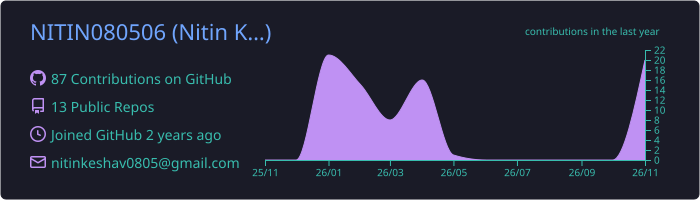
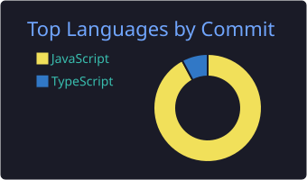

<!-- Animated Top Wave -->

# Hi, I'm Nitin Keshav 👋
### AI & Cloud Engineering Undergrad

<!-- Animated Typing Line -->

Building production-ready serverless pipelines, autonomous LLM agents, and full-stack intelligent systems.

### 🚀 About Me

<table>
  <tr>
    <td width="68%" valign="top">

- ☁️ **Cloud & Serverless:** Designing event-driven architectures on **AWS** (Lambda, EventBridge, DynamoDB, API Gateway, S3, SNS/SES).
- 🤖 **Applied AI & Agents:** Developing LLM-powered test automation agents, NLP document parsers, and multimodal computer vision pipelines.
- 🏆 **Hackathons & Competitions:** Finalist/shortlisted builder across national innovation tracks (**SRIJAN 2026**, **TenzorX 2026**, **NoobHackFest**).
- 🎯 **Currently Focused On:** Scalable cloud-native AI deployment, retrieval-augmented systems, and distributed backend design.

    </td>
    <td width="32%" align="center" valign="middle">
      
    </td>
  </tr>
</table>

### 🛠️ Tech Stack

**Cloud & Infrastructure**  

**AI, ML & Computer Vision**  

**Languages & Backend**  

**Frontend & Databases**  

### 🏗️ Highlighted Architecture & Builds

| Project | Domain | Core Architecture |
| :--- | :--- | :--- |
| **Task Deadline Notification Pipeline** | Cloud / Serverless | Event-driven scheduling using AWS Lambda, EventBridge, DynamoDB, API Gateway, and SNS/SES |
| **AI-Driven Test Automation Agent** | AI Agents / QA | Autonomous test-case synthesis and edge-case detection powered by LLMs and Python APIs |
| **ATS Resume Parsing Engine** | NLP / Backend | High-throughput resume-to-JD matching in Python & PostgreSQL using TF-IDF and Levenshtein metrics |
| **Multimodal Baby Monitoring System** | Edge AI / CV |

### 📊 GitHub Activity

  

  

---

### 🧩 LeetCode Progress

  

